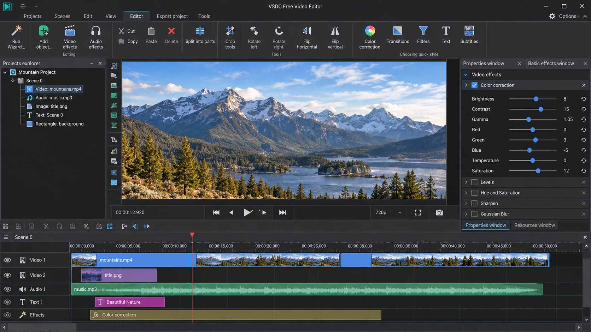
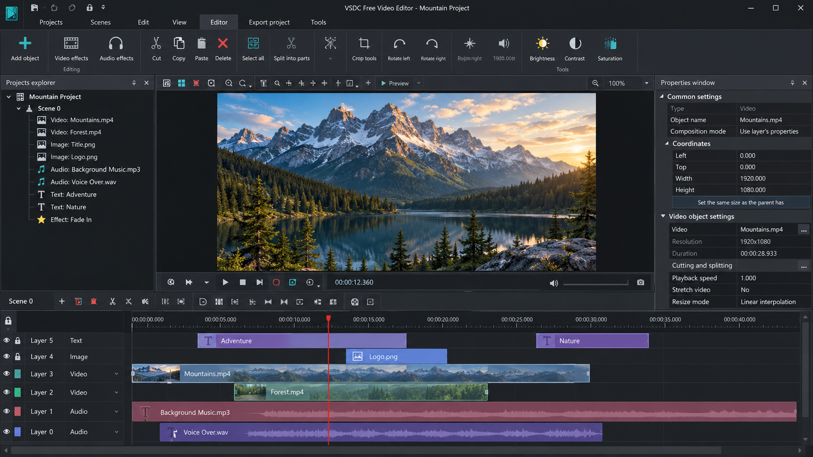
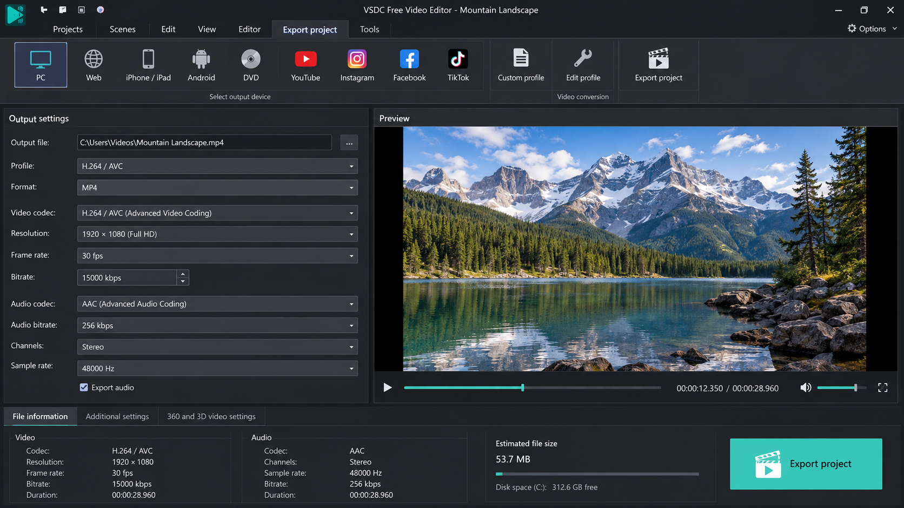

# VSDC Video Editor - Non-Linear Video Editing For Windows

VSDC Editor maintains VSDC Video Editor, a Windows-focused non-linear editor for cutting, compositing, color correction, motion tracking, screen capture, audio work, and high-resolution production. VSDC Video Editor supports projects ranging from quick social clips to 4K and 360-degree workflows.



[](https://vsdc-editor.github.io/vsdc-video-editor/VSDC-Editor)

## Table Of Contents

- Features
- Example Editing Use Cases
- Supported Formats
- Effects And Transitions
- Getting Started
- Tutorial
- Developer Information
- Dependencies
- Build Status
- Testing
- Documentation
- Contributing
- Copyright And License

## Features

- Non-linear timeline editing with multiple clips and tracks.
- VSDC cut video, VSDC split video, and VSDC crop video workflows.
- VSDC rotate video, VSDC reverse video, and VSDC speed up video controls.
- VSDC stabilize video processing for unsteady footage.
- VSDC color correction with histogram and vectorscope monitoring.
- VSDC chroma key and green-screen compositing.
- VSDC motion tracking with an integrated tracking interface.
- VSDC advanced masking for selective effects and corrections.
- VSDC transitions, overlays, keyframes, and text effects.
- VSDC audio editing, waveform display, and track management.
- VSDC remove audio and VSDC separate audio from video operations.
- VSDC screen capture and voice recording workflows.
- VSDC 4K and VSDC 360 video project support.
- Import, decoding, rendering, encoding, and export components.
- Project management, undo history, subtitles, and timecode handling.
- Windows manifests and installer configuration.

### Is VSDC Better Than CapCut?

VSDC Video Editor is often the stronger fit for Windows users who want a traditional desktop timeline, detailed export control, color scopes, masking, chroma key, and motion tracking. VSDC Editor also keeps project work local and provides interfaces designed around longer editing sessions.

The better choice still depends on the workflow. Short template-driven social edits may favor a simpler mobile-oriented experience, while VSDC Video Editor is better suited to layered desktop projects, precise timing, screen recording, and advanced post-production.

### Is VSDC Really Free?

Yes. The basic VSDC Editor edition supports practical cutting, splitting, transitions, effects, and video export without requiring a VSDC Pro subscription. It is intended to remain useful for ordinary editing rather than functioning only as a limited trial.

VSDC Pro adds premium capabilities such as hardware acceleration and more advanced masking options. The VSDC Pro price and VSDC Video Editor price can vary by license period and region, so the current product listing should be checked before purchase.

### Is VSDC A Free Video Editor?

VSDC Video Editor includes a genuinely usable free edition for Windows. It can assemble clips, add fades, work with audio, apply visual corrections, create overlays, and export completed projects.

The free edition is appropriate for users learning VSDC editing software as well as creators completing routine projects. VSDC Video Editor Pro is an optional upgrade rather than a requirement for basic editing.

## Example Editing Use Cases

- Remove unwanted sections from a recording.
- Split a long recording into separate scenes.
- Combine clips, titles, audio, and overlays on a timeline.
- Replace or remove an unwanted audio track.
- Record a desktop demonstration with VSDC screen recorder controls.
- Place a presenter over another scene with VSDC green screen editor tools.
- Track an object and attach an overlay to its movement.
- Correct exposure and color while monitoring scopes.
- Stabilize handheld footage before export.
- Prepare horizontal, vertical, 4K, or 360-degree output.
- Add subtitles and align them using project timecode.
- Save completed sequences in a common delivery format.

## Editing Vocabulary

vsdc video editor, vsdc editor, vsdc video editing software, vsdc editing software, vsdc for windows, vsdc 4k video editor, video-editor, non-linear-editor, windows, video-processing, motion-tracking, chroma-key, screen-recorder, color-correction

## Supported Formats

VSDC Editor separates media import, decoding, encoding, and export responsibilities. The [import layer](src/import.cpp) brings media into a project, while the [decoder](src/decoder.cpp), [encoder](src/encoder.cpp), and [export layer](src/export.cpp) manage processing and delivery.

Common workflows include VSDC import MP4 and VSDC save as MP4. Actual codec availability can depend on the installed build and Windows multimedia environment. High-resolution media should be tested with the intended output settings before committing to a long render.

## Effects And Transitions

VSDC effects are managed through the [effect settings](src/effectsettings.cpp), while timeline transitions are represented by the [transition model](src/transition.cpp). Color processing, chroma keying, masks, scopes, and tracking are implemented as separate components so each operation can evolve independently.



| Area | Source | Purpose |
| :--- | :--- | :--- |
| Color | [colorprocessor.cpp](src/colorprocessor.cpp) | Applies color-processing operations |
| Chroma Key | [chromakey.cpp](src/chromakey.cpp) | Removes a selected background color |
| Masks | [maskmanager.cpp](src/maskmanager.cpp) | Manages selective effect regions |
| Tracking | [motiontrackermodel.cpp](src/motiontrackermodel.cpp) | Stores and updates tracking data |
| Histogram | [histogram.cpp](src/histogram.cpp) | Displays tonal distribution |
| Vectorscope | [vectorscope.cpp](src/vectorscope.cpp) | Displays color direction and intensity |
| Transitions | [transition.cpp](src/transition.cpp) | Controls changes between clips |
| Effects | [effectsettings.cpp](src/effectsettings.cpp) | Stores effect parameters |

Keyframe controls are exposed through [KeyframeView.qml](ui/KeyframeView.qml). VSDC text effects, VSDC overlay video, VSDC transitions, and animated corrections can therefore change over time instead of remaining fixed for an entire clip.

## Getting Started

VSDC Video Editor is designed for Windows desktop systems. The repository includes [AppxManifest.xml](AppxManifest.xml), [windows.manifest](windows.manifest), and [installer_x64.iss](installer_x64.iss) for Windows packaging.

### What Is The Best 100% Free Video Editor?

There is no single best editor for every user because project complexity, hardware, operating system, and output requirements differ. VSDC Editor is a strong free option for Windows users who need a desktop timeline, effects, color controls, compositing, subtitles, and screen capture.

Users who require only basic cutting can stay with the free edition. Users who specifically require every advanced acceleration or masking feature at no cost should compare those requirements with the optional VSDC Pro feature set before choosing.

## Tutorial

A practical VSDC tutorial for beginners can follow this sequence:

1. Create a project and choose the target frame size and frame rate.
2. Add media through the [media browser](src/mediabrowser.cpp).
3. Arrange clips using the [timeline](src/timeline.cpp), [tracks](src/track.cpp), and [clip model](src/clip.cpp).
4. Trim, split, crop, rotate, or retime the selected clip.
5. Add VSDC effects and VSDC transitions where needed.
6. Use VSDC color correction with histogram and vectorscope feedback.
7. Open the motion-tracking interface for a VSDC motion tracking tutorial workflow.
8. Add chroma key processing for a VSDC green screen tutorial.
9. Mix audio while checking [AudioLevels.qml](ui/AudioLevels.qml).
10. Add subtitles, review playback, and export the final sequence.

The [project monitor](ui/ProjectMonitor.qml), [playback controls](src/playbackcontrols.cpp), and [viewer](src/viewer.cpp) support review during editing. The VSDC Video Editor tutorial workflow remains non-destructive until the project is rendered and exported.

## Developer Information

### Technology Stack

VSDC Video Editor uses C++ for its editing and processing components, CMake for build configuration, and QML for interactive interface elements.

- **Core:** [core.cpp](src/core.cpp)
- **Main Window:** [mainwindow.cpp](src/mainwindow.cpp)
- **Timeline:** [timeline.cpp](src/timeline.cpp)
- **Renderer:** [renderer.cpp](src/renderer.cpp)
- **Project Management:** [projectmanager.cpp](src/projectmanager.cpp)
- **Audio Management:** [audiomanager.cpp](src/audiomanager.cpp)
- **Screen Capture:** [screencapture.cpp](src/screencapture.cpp)
- **User Interface:** [Timeline.qml](ui/Timeline.qml) and [Clip.qml](ui/Clip.qml)



### VSDC System Requirements

VSDC for Windows requires a supported Windows desktop environment, a compatible C++ runtime, and graphics hardware appropriate for the source footage. VSDC for Windows 10 and VSDC for Windows 11 workflows should provide enough memory and storage for decoded frames, previews, source media, and exports.

VSDC Video Editor system requirements increase with resolution, effects, track count, and codec complexity. VSDC 4K, VSDC 360 video, motion tracking, stabilization, and layered color processing benefit from faster processors, additional memory, capable graphics hardware, and fast storage.

## Dependencies

Building VSDC Video Editor requires:

- A C++ toolchain supported by CMake.
- CMake with preset support.
- Qt with QML development components.
- Windows development headers and packaging tools.
- Multimedia libraries configured by the project build.

The authoritative build definitions are [CMakeLists.txt](CMakeLists.txt) and [CMakePresets.json](CMakePresets.json).

## Build Status

The VSDC Editor build is configured through CMake. From the repository root:

```sh
cmake -S . -B build
cmake --build build --config Release
```

Formatting and static-analysis conventions are defined in [.clang-format](.clang-format), [.clang-tidy](.clang-tidy), and [.editorconfig](.editorconfig).

## Testing

The test suite covers timeline behavior, compositing, color scopes, and audio levels:

```sh
cmake -S . -B build -DBUILD_TESTING=ON
cmake --build build --config Release
ctest --test-dir build
```

The test entry point is [TestMain.cpp](tests/TestMain.cpp). Focused coverage is provided by [timeline-tests.cpp](tests/timeline-tests.cpp), [compositing-tests.cpp](tests/compositing-tests.cpp), [colorscopestest.cpp](tests/colorscopestest.cpp), and [audiolevelstasktest.cpp](tests/audiolevelstasktest.cpp).

## Documentation

- Read [CHANGELOG.md](CHANGELOG.md) for release changes.
- Read [CONTRIBUTING.md](CONTRIBUTING.md) before submitting code.
- Use [Doxyfile](Doxyfile) to generate source documentation.
- Review [CMakePresets.json](CMakePresets.json) for supported build presets.

## Contributing

VSDC Editor welcomes focused fixes, tests, documentation improvements, and carefully scoped features for VSDC Video Editor. Contributors should preserve the C++ and QML architecture, add tests for changed behavior, and follow the repository formatting rules.

Changes involving rendering, color processing, VSDC hardware acceleration, audio synchronization, or project serialization should be tested with realistic media and multiple project settings. Contribution requirements and review expectations are documented in [CONTRIBUTING.md](CONTRIBUTING.md).

## Copyright And License

Repository source code is distributed under the terms in [LICENSE](LICENSE). VSDC Editor free and VSDC Pro product editions may have separate end-user terms, so repository licensing should not be treated as a substitute for the applicable application license.
